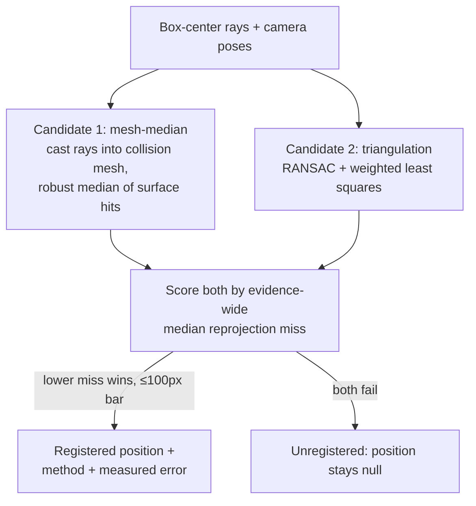

# Pixa — your world, explorable

> Record any room on an ordinary phone. Get back a real 3D world you can walk
> through in a browser — and ask questions about, with every answer grounded in
> what was actually captured.

[](https://github.com/the-first-elder/Pixa/actions/workflows/ci.yml)
🌍 **Live demo:** `https://pixa.autumn-test.workers.dev/scenes/scene_5abb5015` — a real reconstructed living room. No sign-up.

---

## The problem

**Video is dead the moment you stop watching it.** A 90-second walkthrough of
an apartment, a workshop, a venue — it holds the answers to a hundred questions
(*where's the table? what's behind that door? how wide is the hallway?*), but
there's no way to ask. You scrub a timeline like it's 2006.

Meanwhile, capturing real 3D spaces is still a pro sport: LiDAR phones, depth
cameras, desktop photogrammetry pipelines, hours of processing. And the new
wave of "AI world" demos mostly fakes it — a generated flythrough, a NeRF-ish
blob with no notion of *objects*, confident answers about things that were
never recorded.

Pixa attacks all three at once:

| Dead end today | What Pixa does instead |
|---|---|
| Flat video you can only replay | **Real Gaussian-splat reconstruction** from the footage — orbit, fly, walk inside it |
| 3D capture needs pro gear + expertise | **Phone video + guided capture** (pace/sharpness/coverage coaching while you record) |
| AI that hallucinates your space | **Grounded spatial intelligence** — every object position is triangulated *and* independently reprojected; the system says "not captured" instead of inventing |

Three rules the whole system obeys: **real 3D from real footage** (never
generated scenery), **detection ≠ registration** (a label is not a position
until geometry proves it), and **observed / established / inferred / unknown**
(the assistant distinguishes what it saw from what it concludes).

---

## What it feels like

1. **Capture** — record in the browser with live coaching, or upload an MP4. Sign in with Google; your video is stashed and restored across the login.
2. **Reconstruct** — frames → camera poses → 3D Gaussian splats → collision mesh. Leave and come back; progress bars and notifications track it.
3. **Explore** — orbit, fly, or walk the rooms (WASD, eye height, walls + ceiling constrain you). Take a guided tour, jump between captured viewpoints.
4. **Ask** — *"take me to the entrance," "show me the table," "how wide is the doorway?"* The assistant flies the camera, highlights objects, measures — and shows its evidence. Voice in, spoken answers out.

---

## How it works

### End-to-end pipeline

```mermaid
flowchart LR
    subgraph Capture
        A[Phone video / browser recorder]
        B[Guided capture: pace, sharpness, light, coverage compass]
    end
    subgraph Reconstruct
        C[FFmpeg frames @2fps]
        D[Spirula SfM: camera poses]
        E[3DGS training: 7k/15k/30k iters]
        F[SPZ splats + GLB collision mesh]
    end
    subgraph Index
        G[Spark: object labels]
        H[SAM 3.1 video track: per-instance 2D tracks]
        I[Hybrid registration: mesh-median vs triangulation]
        J[Independent reprojection audit]
    end
    subgraph Experience
        K[Orbit / Fly / Walk viewer]
        L[Grounded assistant + tools]
    end
    A --> B --> C --> D --> E --> F --> G --> H --> I --> J --> K --> L
```



### Spatial indexing: the part we're proudest of

Per-frame detectors associate instances geometrically — fragile when two
chairs look alike. Pixa instead sends **one SAM 3.1 video-track request per
scene**: stable per-instance IDs with per-observation confidence, at ~$0.04
per scene (vs ~$0.64 for dense per-frame calls).

Then positions are *earned*, not assumed:



Why two candidates? Measured the hard way: near-parallel rays let RANSAC
hallucinate a "painting" **5 cm in front of the lens** with a "tight" 0.027
residual. Tight residuals don't imply correct positions — so an independent
verifier reprojects every position into its evidence frames and rejects what
doesn't land on its own boxes. Current standing result: **11/11 PASS
(0–87 px)** on the reference scene, with method + error persisted per entity.

Key fixes the measurements forced (all verified, none assumed):

- **VFR/edit-shifted sources break frame-index math** (measured +6 frames) → the tracker consumes a re-encoded *recon clip* whose frames are identical to reconstruction frames by construction (SSIM-verified).
- **Frame-path boxes are Pipeline-A pixels vs B-frame intrinsics** (1.25× silent error) → scale derived per scene from the actual files.
- **SAM 500s on degenerate prompt boxes** (a 3 px edge sliver killed a request twice) → prompt hygiene + best-overlap carry + 5xx-only retry + checkpoints. Billed calls never auto-retry on timeout.
- **Spark probes starve at small token budgets** (298 reasoning tokens eat the budget → null content → empty indexes) → raised budgets + null guards.

---

## Features

- **Three viewer modes** — orbit, fly, and rooms-walk with collision proxy, ceiling clamp, eye-height snap, gravity leveling.
- **Grounded assistant** — 8 tools (`navigateToLocation`, `focusOnObject`, `highlightObjects`, `showRoute`, `inspectLocation`, `compareLocations`, `measureObject`, `calibrateScale`), evidence thumbnails, voice input + spoken answers, confirm-before-act.
- **Guided capture** — live pace meter, sharpness/light checks, coverage compass with tilt guidance, weak-moment chapters, shot checklist, capture report before submit, resolution honesty (flags upscaled recompressed sources).
- **My Worlds** — searchable/sortable card library with thumbnails, content stats (objects · views · coverage), job progress, inline rename, owner-gated delete.
- **Auth** — Google OAuth (Auth.js JWT), in-context sign-in modal, file-stash restore across login, private-by-default scenes, legacy-record grandfathering.
- **Long video** — chunked resumable uploads, segment manifests with split/merge, per-segment jobs, partial-success recovery.
- **Quality tiers** — fast preview (~7k) / balanced (~15k) / full (30k) with ultra+2M+mild suppression on full runs.

---

## Measured results (not marketing)

| Metric | Value | Source |
|---|---|---|
| Registration audit | 11/11 PASS, 0–87 px miss | `verify-registration.mts` |
| Indexing cost | ~$0.04–0.10 / scene | billed frames accounting |
| Recon quality (478p source) | PSNR 32.7–40.1, SSIM up to 0.977, 2M splats | `docs/building-quality-report.md` |
| Frames registered | 173/180 (96%) | remaster job `job_663dcb05` |
| Auth suite | 15/15 | `scripts/test-auth.sh` |
| Notifications suite | 4/4 | `scripts/test-notifications.mts` |
| Long-video suite | 12/12 | `scripts/test-longvideo.sh` |

And one honest ceiling: all test footage is 478p WhatsApp-compressed. The
pipeline is near-optimal *for that footage* — real resolution gains need
1080p+ captures, which the guided recorder now steers toward.

---

## Repo layout

```
apps/web/                 Next.js + TypeScript + Tailwind + Three.js + Spark viewer
services/reconstruction/  Python worker: ingest → frames → poses → 3DGS → manifest
packages/shared-types/    TS types shared by web + worker contracts
packages/scene-schema/    Scene manifest + graph schema (versioned)
packages/model-adapters/  Meta Model API clients (spark/sam/voice/image)
workers/pixa-proxy/       Cloudflare edge proxy (public URL → Mac server)
scripts/                  Indexing, tracking, registration, verification, tests
docs/                     Verified API notes, strategy, protocol, architecture
.github/workflows/ci.yml  Tests on every push (typecheck, worker, notifications, auth)
```

---

## Quickstart

```bash
cp .env.example .env        # add META_API_KEY (never commit .env)
npm install
npm run dev                 # apps/web on http://localhost:3000

# Reconstruction worker (Apple Silicon, Spirula binary in ~/.pixa/bin)
cd services/reconstruction
python3 -m venv .venv && source .venv/bin/activate
pip install -r requirements.txt
python -m worker probe <video.mp4>
```

Google OAuth (enables sign-in + gated creates): follow
[`docs/auth-setup.md`](docs/auth-setup.md) — three vars, one redirect URI.

Production here is a **Mac server behind a Cloudflare edge worker**:
`npm run build` → `next start` → `cloudflared tunnel` →
`wrangler deploy`. The worker only forwards traffic; training, files, and
sessions live on the Mac. If the tunnel restarts,
`bash scripts/sync-tunnel.sh` re-points and redeploys the proxy.
(Permanent fix: named tunnel + the two repo secrets documented in
`.github/workflows/ci.yml`.)

---

## Costs (measured, steady state)

- Scene indexing: **~$0.04–0.10** (SAM video frames + Spark probes; every billed call accounted, timeouts never retried).
- Reconstruction: **$0** (local Spirula on your GPU; optional KIRI cloud path stays behind an explicit spend flag).
- Hosting the demo link: **$0** (Cloudflare free tier + this machine).

---

## Roadmap

- [ ] Named Cloudflare tunnel (stable public URL through restarts)
- [ ] Motion-gated dynamic masking (mask what *moves*, not every "person" — static photo content taught us that)
- [ ] Sub-50 px registration tier (occlusion-aware box centers, denser meshes)
- [ ] Hosted production (R2 + external GPU + managed DB) when demo traffic earns it

## Standing rules

1. Real 3D from real footage — never fake reconstruction.
2. AI actions must visibly execute in the scene.
3. Detection ≠ registration: no 3D position without provenance.
4. Observed / established / inferred / unknown — never invent unseen spaces.
5. Secrets server-side only. Standard (non-contributor) models for private captures.
