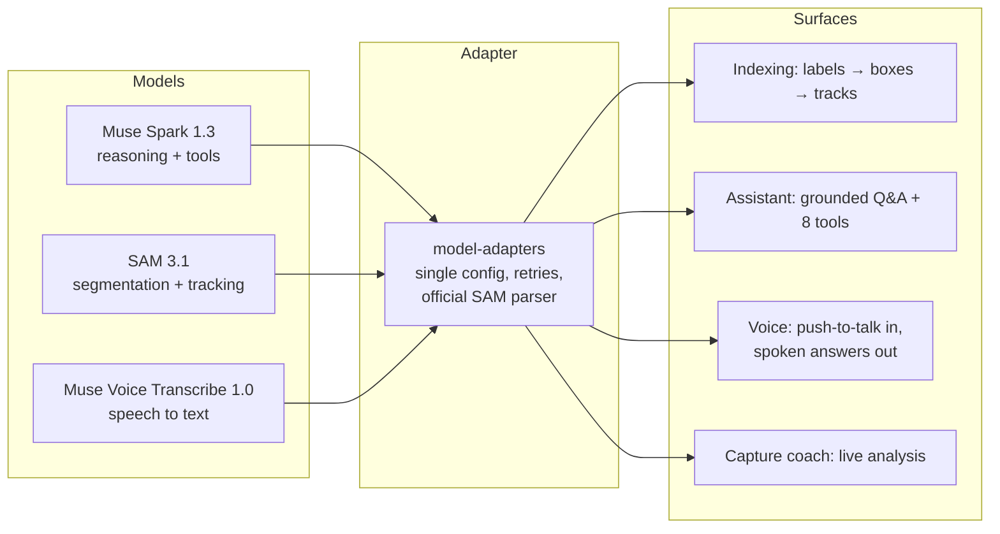
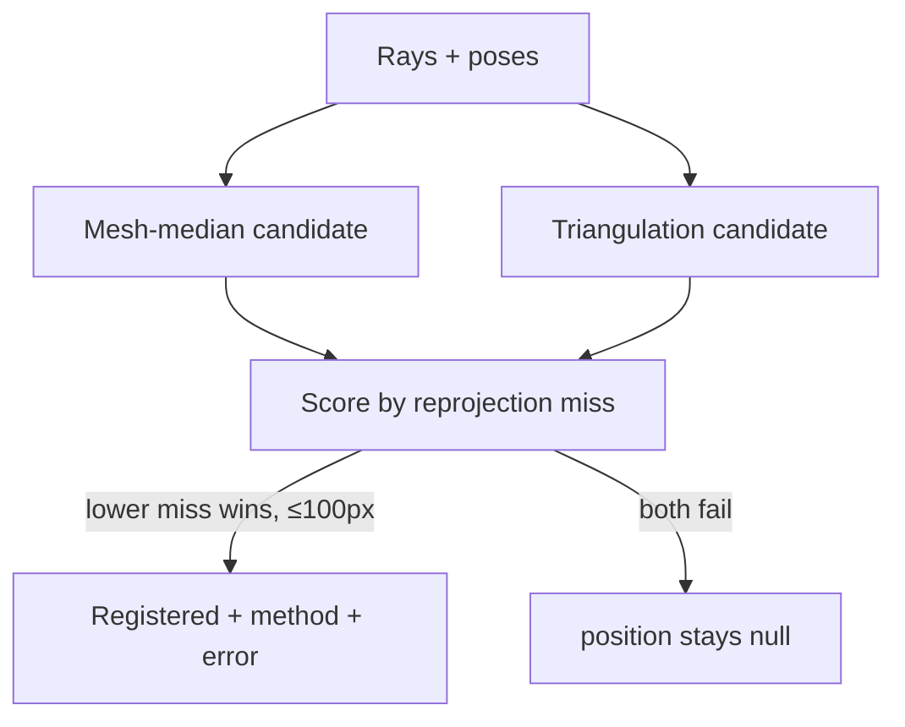

# Pixa — every space you film becomes a world you can enter

> Record any room on an ordinary phone — up to a 30-minute walkthrough. Get
> back a real 3D world you can walk through in a browser and *ask questions
> about*, with every answer grounded in what was actually captured.

[](https://github.com/the-first-elder/Pixa/actions/workflows/ci.yml)
🌍 **Live demo, no sign-up:** `https://pixa.autumn-test.workers.dev/scenes/scene_5abb5015`

---

## The problem: video is where spatial knowledge goes to die

A 30-minute walkthrough of an apartment, a workshop, a venue holds the answers
to a hundred questions — *where's the table? what's behind that door? how wide
is the hallway?* — but there's no way to ask. You scrub a timeline like it's 2006.

The alternatives all miss:

- **3D capture is a pro sport.** LiDAR phones, depth cameras, desktop photogrammetry, hours of processing. Ordinary people with ordinary phones are locked out.
- **"AI world" demos fake it.** Generated flythroughs and NeRF-ish blobs with no notion of *objects*, giving confident answers about things that were never recorded.
- **Nobody trusts AI about physical space.** And they're right not to — until positions are *proven*, not predicted.

**The market is everyone who films a space to remember, show, or document it:**
renters and agents walking apartments, museums and workshops that visitors
question, venues and site managers documenting facilities, travelers previewing
places, anyone checking access and layout before arriving in person. They all
already shoot the video. None of them can interrogate it.

---

## The product: film it, step inside, interrogate it

1. **Capture** — record in the browser with a live coach (pacing, sharpness, light, coverage), or upload an MP4 up to ~30 minutes. Long captures auto-segment into chapters.
2. **Reconstruct** — frames → camera poses → 3D Gaussian splats → collision mesh. Leave and come back; progress bars and notifications track it.
3. **Explore** — orbit, fly, or *walk the rooms* (WASD, walls and ceilings constrain you). Guided tours, captured viewpoints, public share links.
4. **Ask** — *"take me to the entrance," "show me the table," "how wide is the doorway?"* The assistant flies the camera, highlights objects, measures — shows its evidence, and says "not captured" instead of inventing.

Sign in with Google, get a visual **My Worlds** library: searchable, sortable, thumbnails, content stats, inline rename, owner-gated delete.

---

## AI integration: the Meta models inside Pixa

Everything AI flows through one door: `packages/model-adapters` talks to
`https://api.meta.ai/v1`, model IDs live in one config file, secrets never
leave the server, and private captures use Standard (non-contributor) models —
your footage never trains Meta's models.

| Model | ID | Where it runs | Billed |
|---|---|---|---|
| **Muse Spark 1.3** | `muse-spark-1.3` (Chat Completions) | Assistant, label discovery, capture analysis | $1.25 / 1M in, $4.25 / 1M out |
| **SAM 3.1** | `sam-3.1` (Responses API) | Detection boxes, video tracks, masks | $2.50 / 1K images, $0.20 / 1K video frames |
| **Muse Voice Transcribe 1.0** | `muse-voice-transcribe-1.0` | Push-to-talk speech input | $0.18 / audio hour |
| Muse Image 1.0 | `muse-image-1.0` | Adapter built, not wired into UX yet | — |



**Spark does the thinking.** It names object categories during indexing (union over probe frames, synonym merging), runs the assistant's tool-calling loop — `navigateToLocation`, `focusOnObject`, `highlightObjects`, `showRoute`, `inspectLocation`, `compareLocations`, `measureObject`, `calibrateScale` — with JSON-schema structured outputs, session memory, and confirm-before-act. Every answer cites evidence (entity labels, frame ids) and says "not captured" when the footage doesn't cover the question. Two things we measured and coded around: Spark reasons first (~300 tokens), so budgets ≤2048 starve the output to `null` (we run 4096 with null guards); and its outputs vary slightly run to run, so registration never trusts a single response (RANSAC + confidence weighting).

**SAM 3.1 does the seeing.** Image mode returns detection boxes for discovery; video mode returns full-clip tracks — stable per-instance IDs with per-observation confidence and compact `one_bit` masks. Track, don't detect: one box-prompted video request replaced up to 256 per-frame calls, cutting indexing from ~$0.64 to ~$0.04 per scene *and* fixing instance association. Hard-won prompt hygiene is baked in: degenerate sub-6px boxes 500 the API (filtered), best-overlap boxes carry IDs across chunks, 16 objects per request max, and mask payloads are base85 that may contain `|` — parsed only with the official `@meta-sam/parser`, never hand-tokenized.

**Voice does the listening.** Push-to-talk records WAV mono PCM, Muse Voice Transcribe returns the text, the assistant answers, and the answer is spoken back — ask about your space out loud while walking it.

**One honest boundary:** there is no Meta text-to-speech in the loop — spoken answers are browser speech synthesis, and this section says so instead of implying otherwise. Same for Muse Image: the adapter is written, but it ships nowhere in the UX today, so it gets no demo slot.

## Why this wins: the moat is verification

Anyone can call a segmentation API. Almost nobody proves their geometry. Pixa's
pipeline measures whether an object position is credible *instead of trusting
a plausible-looking result*:

```mermaid
flowchart LR
    subgraph Capture
        A[Phone video up to ~30 min]
        B[Live coaching + auto-chapters]
    end
    subgraph Reconstruct
        C[Frames @2fps]
        D[SfM camera poses]
        E[3DGS training 7k/15k/30k]
        F[Splats + collision mesh]
    end
    subgraph Prove
        G[Spark labels]
        H[SAM 3.1 video tracks\nstable per-instance IDs]
        I[Mesh-median vs triangulation]
        J[Independent reprojection audit]
    end
    subgraph Experience
        K[Orbit / Fly / Walk]
        L[Grounded assistant + tools]
    end
    A --> B --> C --> D --> E --> F --> G --> H --> I --> J --> K --> L
```





Concrete edges competitors don't have:

- **Track, don't detect.** One SAM 3.1 video request per scene (not 256 image calls): stable IDs, per-observation confidence, **~$0.04/scene** — 16× cheaper and strictly more correct.
- **Two estimators, one judge.** Mesh-median and RANSAC triangulation compete; evidence-wide reprojection picks the winner. Caught a "painting" fit 5 cm in front of the lens hiding behind a "tight" 0.027 residual.
- **Failure as a feature.** VFR frame-index drift (+6 frames measured), 1.25× pixel-scale mismatch, degenerate prompt boxes, reasoning-starved probes — each caught by measurement, each fixed structurally, each documented.
- **Unit economics that scale.** Indexing $0.04–0.10/scene, reconstruction $0 (local GPU), demo hosting $0. At 1,000 scenes that's ~$40–100 of AI spend — a rounding error beside any subscription price.

---

## Proof, not promises

| Claim | Evidence |
|---|---|
| Positions are real | 11/11 independent reprojection audit PASS (0–87 px) |
| Cheap to index | Billed-frame accounting, every call logged |
| Real reconstructions | 173/180 frames registered, 2M splats, SSIM 0.977, PSNR up to 40.1 |
| Auth holds | 15/15 matrix (anon blocked, owners isolated, legacy grandfathered) |
| Long video works | 12/12 (chunked uploads, segments, recovery) |
| CI on every push | Typecheck, worker smoke, notifications 4/4, auth matrix |

Honest ceiling, stated upfront: test footage is 478p WhatsApp-compressed — the
pipeline is near-optimal *for that footage*. 1080p+ captures are the next
leap, and the guided recorder already steers users toward them.

---

## Business: where the money is

- **Who pays first:** property (listings buyers can walk + query), venues/facilities (navigable records), culture/learning (spaces that answer back). All already shoot video; all pay for time saved on site.
- **Pricing room:** AI cost per scene is cents; reconstruction is free on-device. Any seat or per-space price above a few dollars is nearly pure margin.
- **Defensibility:** the verification layer (provenance per object, rejection of bad geometry) compounds with every scene — fakers can't retrofit trust.
- **What winning unlocks:** named-tunnel-to-production hardening now; then hosted tier (object storage + cloud GPU + managed DB) when demo traffic earns it, 1080p-first capture, and sub-50 px registration.

---

## Try it / build it

**Live demo** (public scene, nothing to install):
`https://pixa.autumn-test.workers.dev/scenes/scene_5abb5015`

```bash
cp .env.example .env        # add META_API_KEY (never commit .env)
npm install
npm run dev                 # apps/web on http://localhost:3000
```

Google OAuth (sign-in + gated creates): [`docs/auth-setup.md`](docs/auth-setup.md).
Production here = Mac server behind a Cloudflare edge worker; see
`workers/pixa-proxy` + `scripts/sync-tunnel.sh`. Permanent hardening (named
tunnel, repo secrets) is documented in `.github/workflows/ci.yml`.

```
apps/web/                 Next.js + TypeScript + Tailwind + Three.js + Spark viewer
services/reconstruction/  Python worker: ingest → frames → poses → 3DGS → manifest
packages/model-adapters/  Meta Model API clients (spark/sam/voice/image)
packages/scene-schema/    Versioned scene manifest + graph schema
workers/pixa-proxy/       Cloudflare edge proxy (public URL → Mac server)
scripts/                  Indexing, tracking, registration, verification, tests
docs/                     Verified API notes, reports, protocol, architecture
```

## Standing rules

1. Real 3D from real footage — never fake reconstruction.
2. AI actions must visibly execute in the scene.
3. Detection ≠ registration: no 3D position without provenance.
4. Observed / established / inferred / unknown — never invent unseen spaces.
5. Secrets server-side only. Standard (non-contributor) models for private captures.
