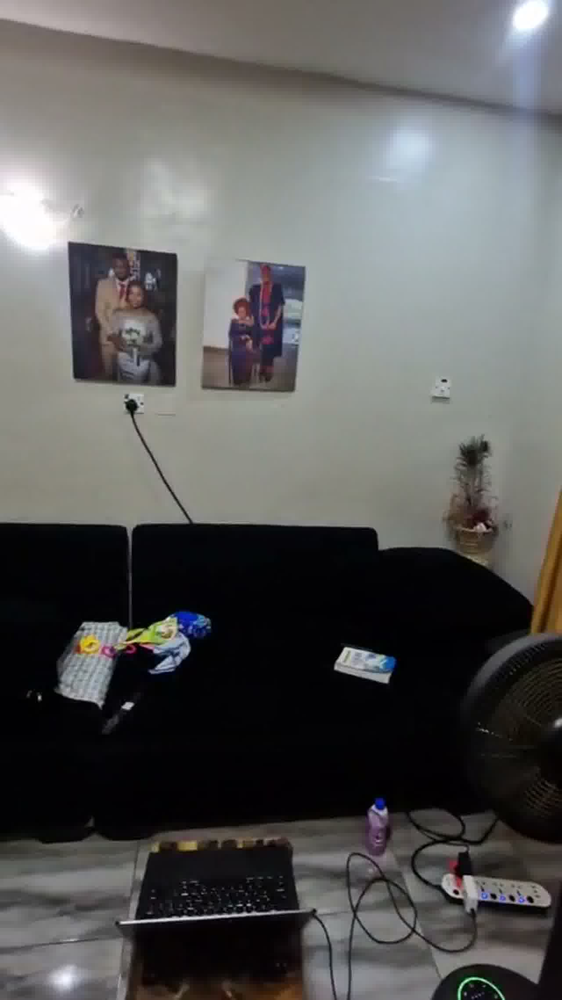
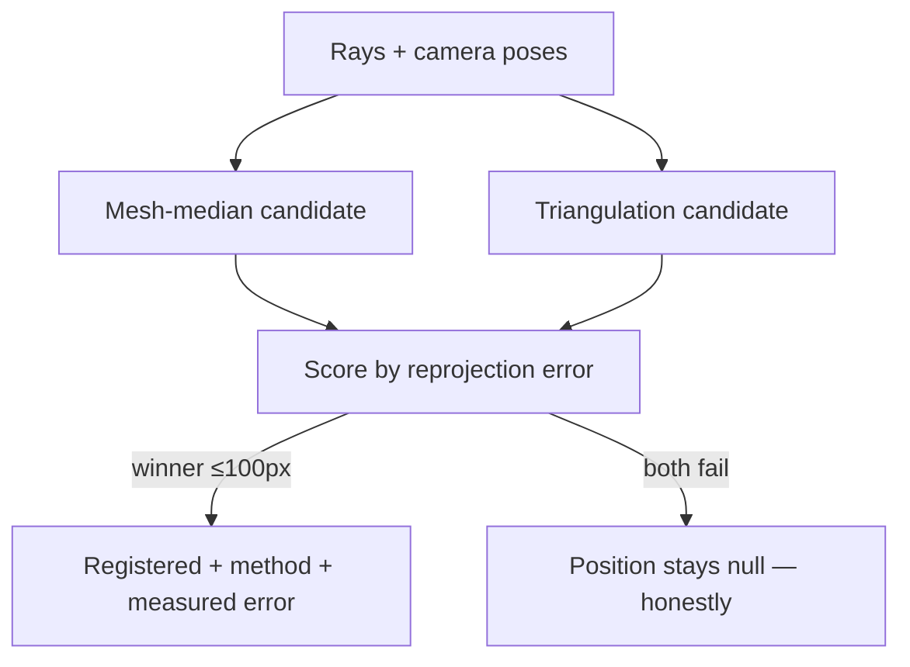

# Pixa — film a room, step inside it, ask it anything

> Record any space on an ordinary phone — one pass or several — and get back a
> real 3D world you can **walk through in a browser** and **interrogate in
> plain language**: _"go to the blue towel," "how wide is the doorway,"
> "where can I buy a chair like this?"_ Every scene answer is grounded in
> measured geometry. Every external answer carries its sources.

[](https://github.com/the-first-elder/Pixa/actions/workflows/ci.yml)
**Live demo (no sign-up):** https://pixa.autumn-test.workers.dev/scenes/scene_48a2bb9e



---

## Why Pixa exists

Video is where spatial knowledge goes to die. A walkthrough of an apartment,
a workshop, a venue holds the answers to a hundred questions — but you can
only scrub a timeline. The alternatives all miss:

- **3D capture is a pro sport** — LiDAR phones, depth rigs, desktop
  photogrammetry, hours of processing.
- **"AI world" demos fake it** — generated flythroughs with no objects, no
  measurements, confident answers about things never recorded.
- **Nobody trusts AI about physical space** — rightly, until positions are
  _proven_, not predicted.

Pixa's rules, enforced in code: **real 3D from real footage** (never
generated scenery), **detection ≠ registration** (a label is not a position
until geometry proves it), and **observed / established / inferred /
unknown** — the assistant distinguishes what it saw from what it concludes,
and says "not captured" instead of inventing.

**Who it's for:** renters and agents walking apartments, venues and site
managers documenting facilities, museums and workshops visitors question,
travelers previewing places, anyone checking layout and access before
arriving. They already shoot the video. Now they can ask it questions.

---

## What you can do

|                            |                                                                                                                                                                           |
| -------------------------- | ------------------------------------------------------------------------------------------------------------------------------------------------------------------------- |
| **Guided capture**         | In-browser recorder with live pacing/sharpness/light coaching, coverage compass, wake lock (sleep can't kill your recording), auto-saved device copies of every pass      |
| **Multi-pass capture**     | Film what you missed in extra passes; they're staged individually (one dropped pass retries alone) and joined into one complete video                                     |
| **Real reconstruction**    | Frames → camera poses (SfM) → 3D Gaussian splats → collision mesh, on-device at $0, tiered quality (Preview / Balanced / Full)                                            |
| **Walk, don't just orbit** | Orbit, free-fly, and eye-level **Walk** mode: enter at a real captured viewpoint, pointer-lock mouse-look, WASD + touch joystick, walls/floor/ceiling constrain you      |
| **Ask anything**           | _"Go to the blue towel"_ — the camera glides there and focuses. _"How big is it?"_ — measured, with calibration. _"Where can I buy one?"_ — live web search, with sources |
| **Voice**                  | Push-to-talk runs the identical pipeline as typing; answers are spoken back                                                                                               |
| **My Worlds**              | Searchable card library: thumbnails, objects/views/coverage stats, job progress with ETA, completion emails, inline rename, delete                                        |
| **Accounts**               | Google sign-in (in-context modal), private-by-default scenes, public share links, per-user fairness when the GPU queue is busy                                            |

---

## How it works

```mermaid
flowchart LR
    subgraph Capture
        A[Phone video, 1..N passes]
        B[Live coaching + wake lock]
    end
    subgraph Reconstruct
        C[Frames, adaptive fps]
        D[SfM poses, tiered quality]
        E[3DGS training, slot-guarded GPU]
        F[SPZ splats + collision mesh]
    end
    subgraph Prove
        G[Spark labels]
        H[SAM 3.1 video tracks]
        I[Mesh-median vs triangulation]
        J[Reprojection audit]
    end
    subgraph Experience
        K[Orbit / Fly / Walk]
        L[Assistant: scene tools + web]
    end
    A --> B --> C --> D --> E --> F --> G --> H --> I --> J --> K --> L
```



### The part we're proudest of: positions are earned

Per-frame detectors can't tell two chairs apart. Pixa sends **one SAM 3.1
video-track request per scene** — stable per-instance IDs with confidence,
~$0.04/scene instead of ~$0.64 — then _proves_ each position two ways and
keeps only what survives:



Measured the hard way: near-parallel rays once let RANSAC place a
"painting" **5 cm in front of the lens** behind a "tight" 0.027 residual.
Tight residuals don't imply correct positions — so an independent verifier
reprojects every position into its evidence frames and rejects what
doesn't land. Standing result on the reference scene: **11/11 PASS
(0–87 px)**, with method + error stored per entity.

Attribute questions work the same honest way: _"the blue towel"_ ranks the
blue-labeled instance first; when several instances can't be separated,
all are highlighted and the assistant says so, using the attached evidence
frames to tell them apart — never a silent guess.

---

## The Meta models inside

One door for all AI: `packages/model-adapters` → `https://api.meta.ai/v1`.
Secrets never leave the server; private captures use Standard
(non-contributor) models — your footage never trains Meta's models.

| Model                                 | Role in Pixa                                                                                                                        | Billed                                 |
| ------------------------------------- | ----------------------------------------------------------------------------------------------------------------------------------- | -------------------------------------- |
| **Muse Spark 1.3**                    | Assistant tool-calling (navigate, focus, highlight, route, inspect, compare, measure, calibrate), label discovery, capture analysis | $1.25/1M in, $4.25/1M out              |
| **SAM 3.1**                           | Detection boxes + full-clip video tracks with per-instance confidence and masks                                                     | $2.50/1K images, $0.20/1K video frames |
| **Muse Voice Transcribe 1.0**         | Push-to-talk speech input                                                                                                           | $0.18/audio hour                       |
| **Web search** (Spark, Responses API) | "Where can I buy…", prices, product facts — cited sources, never scene evidence                                                     | $2.50/1K searches                      |
| Muse Image 1.0                        | Adapter built, deliberately not in the UX yet                                                                                       | —                                      |

War stories the code now encodes: Spark reasons first (~300 tokens), so
small budgets starve output to `null` (we run 4096 + null guards); SAM
500s on degenerate sub-6px prompt boxes (filtered); mask payloads are
base85 that may contain `|` (official parser only); VFR phone footage
breaks frame-index math (+6 frames measured), so the tracker consumes a
re-encoded clip whose frames are identical to reconstruction frames by
construction.

---

## Measured, not marketed

| Claim                    | Evidence                                                                                                                                                |
| ------------------------ | ------------------------------------------------------------------------------------------------------------------------------------------------------- |
| Positions are real       | 11/11 independent reprojection audit (0–87 px)                                                                                                          |
| Indexing is cheap        | ~$0.04–0.10/scene, billed-frame accounting                                                                                                              |
| Reconstructions are real | 173/180 frames registered, 2M splats, SSIM 0.977, PSNR up to 40.1                                                                                       |
| Delivery is fast         | SPZ auto-conversion (452 MB PLY → 39 MB), streamed with Range/ETag                                                                                      |
| Tests pass               | Auth 20/20 · Scenes 9/9 · Grounding 5/5 · Notify 5/5 · Notifications 4/4 · Worker-perf 5/5 · Admission 3/3 · Long-video 12/12 — all in CI on every push |

Honest ceiling: most test footage is 478p recompressed. The pipeline is
near-optimal _for that footage_; 1080p+ originals are the next leap, and
the capture coach already steers users toward them (and warns, in the UI,
when a source is recompressed).

---

## Engineering notes (the unglamorous 80%)

- **Multi-user fairness**: GPU training is flock-slot-guarded FIFO
  (`WL_TRAIN_SLOTS`, default 1 — unified memory is the honest limit);
  extraction/SfM run concurrently; per-owner (2) + global (6) admission
  caps keep one account from monopolizing the machine.
- **Uploads that survive phones**: resumable chunked uploads (3 parallel
  workers), per-pass staging with individual retries, one automatic
  retry on connection loss, wake lock + on-screen keep-awake state,
  auto-saved device copy of every recorded pass.
- **Auth that can't lie**: Google OAuth via Auth.js; a session whose
  identity isn't a real Google subject is rejected outright (a fallback
  once silently re-identified users as random strangers — regression-
  tested so it can never return).
- **No dead ends**: failed or empty scenes offer re-run, replace-video,
  and delete right on the scene page; completion mail (Brevo) fires
  at-most-once, stamp-before-send, and never fails a job.
- **Rendering**: Spark streams assets directly (no Blob copy), LOD tree
  for large scenes, adaptive resolution that only steps down under real
  GPU pressure.

---

## Run it

```bash
cp .env.example .env        # META_API_KEY (+ Google OAuth for sign-in)
npm install
npm run dev                 # http://localhost:3000
```

Reconstruction worker (Apple Silicon; Spirula binary in `~/.pixa/bin`):

```bash
cd services/reconstruction
python3 -m venv .venv && source .venv/bin/activate
pip install -r requirements.txt
python -m worker probe <video.mp4>
```

Google OAuth setup: [`docs/auth-setup.md`](docs/auth-setup.md).
Production topology here: Mac server behind a Cloudflare edge worker
(`workers/pixa-proxy`); tunnel recovery via `scripts/sync-tunnel.sh`;
always-on agents in `ops/launchd/`. CI (`.github/workflows/ci.yml`) runs
every suite above on push and deploys the edge worker after green.

```
apps/web/                 Next.js + Tailwind + Three.js + Spark viewer
services/reconstruction/  Python worker: ingest → poses → 3DGS → SPZ/mesh
packages/model-adapters/  Meta Model API clients (spark/sam/voice/search)
packages/scene-schema/    Versioned scene manifest + graph schema
workers/pixa-proxy/       Cloudflare edge proxy (public URL → Mac server)
scripts/                  Indexing, registration, verification, all tests
docs/                     API notes, benchmarks, protocol, architecture
```

## Roadmap

- [ ] Named Cloudflare tunnel (stable URL through restarts)
- [ ] Motion-gated dynamic masking (mask what _moves_ — static photo people taught us the difference)
- [ ] Sub-50 px registration tier
- [ ] Hosted tier (object storage + cloud GPU + managed DB) when traffic earns it

## Standing rules

1. Real 3D from real footage — never fake reconstruction.
2. AI actions must visibly execute in the scene.
3. Detection ≠ registration: no 3D position without provenance.
4. Observed / established / inferred / unknown — never invent unseen spaces.
5. Secrets server-side only. Standard models for private captures.
